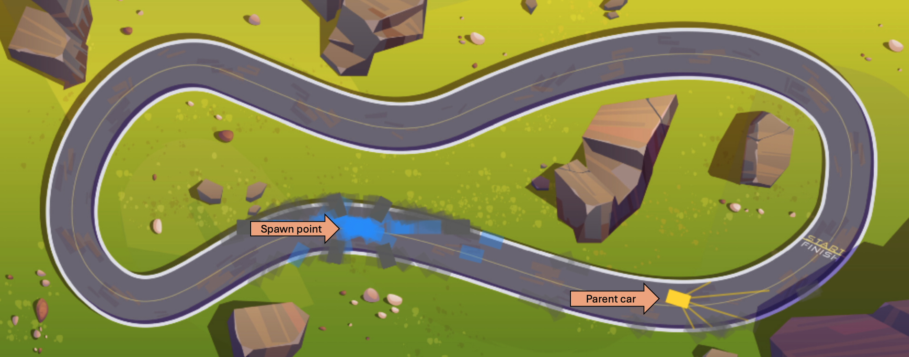

# Neural-Network Racing Cars 

**[Live Demo](https://pvalissery.github.io/Neural-Network---Racing-Cars/)**

This is a 2D self-driving car simulation built using JavaScript and the HTML5 Canvas API. No external machine learning libraries, no bloated dependencies. I wanted to learn how to code a teachable network and I wrote the code based on a bunch of youtube tutorials with modifications, notably the ability to upload any picture and use it to train the model. This is a  Multi-Layer Perceptron neural network and a genetic algorithm trying to figure out how to drive without smashing into walls.

### How It Works
The simulation drops a population of 600 cars onto a track. Each car is equipped with a 5-ray sensor array that detects obstacles pixel-by-pixel. 

1. **Upload a Track:** Upload any custom track image. [This is the picture that I used for training.](https://www.vecteezy.com/vector-art/13868065-race-track-for-cars-top-view-asphalted-road-loop) The script reads the canvas pixel data to dynamically figure out what is road and what is an obstacle.
2. **Set the Start Point:** Click anywhere on the track to spawn generation 1. 
3. **Play God (Selection):** Watch them drive. Most will crash immediately. Find the one that makes it the furthest and click it to lock it in as the "parent"
4. **Evolve:** Hit the "Spawn Next Generation" button. The new batch of cars will clone the parent's brain and apply random mutations to the weights and biases.
5. **Trash the Brain:** Sometimes the gene pool gets stuck doing endless donuts in a corner or crash into a wall. Click on "Trash Brains & Reset" to wipe the neural weights, reset the learning cycle counter, and start fresh.

### Under the Hood
* **Code:** Vanilla JS and HTML5 Canvas.
* **Brain:** A custom feed-forward neural network (`[5 inputs, 6 hidden nodes, 4 outputs]`).
* **Evolution:** Genetic algorithm using deep copies and linear interpolation (lerp) for mutations.
* **Collision Logic:** Pixel-color tolerance checking against the track's image data to allow for gradient shadows and lane markings.

### Running it Locally
You don't need a build step, Webpack, or a package manager. Just clone the repo, open `index.html` in your browser, and you are good to go.
